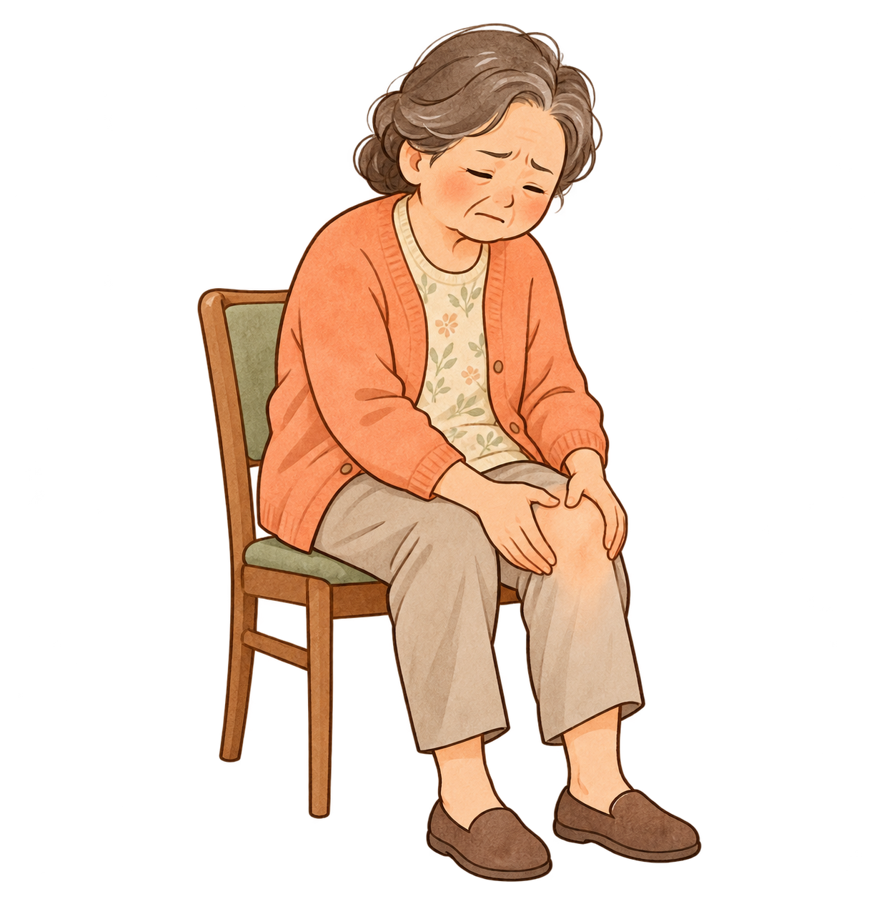

# 医学科普长图 Skill v1.0

把中文医学文章或宣教文案制作成适合手机阅读的手绘风格长图。默认保留用户原文，不加署名、不显示图号，内容较长时可分段制作后拼接。支持左右图文交错、上下图文和正文段落间插画，按内容选择合适布局。

长图以暖米白纸张和手绘水彩插画为基础：主标题可搭配淡橙色水彩笔刷底纹，小标题使用浅杏色衬底，正文周围点缀少量浅绿色植物、细线和小色块，重点提示可使用柔和的浅绿色背景。装饰随内容灵活安排，文字保持清晰；默认不显示图号和图注。

> **素材库持续更新中，介意者暂时勿用。** 目前仅有 5 张通用插画，离线模式可能找不到完全匹配的图片；字体可能缺少部分生僻字，遇到缺字时需要换用覆盖该字的字体。

## 两种生成方案

技能会根据当前 Agent 可用的能力选择路径；用户的明确要求优先。**有可用生图工具时应优先生成贴合主题的插画；文字准确性不是改用固定素材库的理由。**

| | Agent 自带图片生成 | 本地素材与排版 |
| --- | --- | --- |
| **适用情况** | Agent 已有可用的图片生成或编辑功能 | Agent 没有图片生成功能，但能读取文件、运行本地程序 |
| **插画来源** | 使用 Agent 的图片工具生成，可以按主题创作新的插画 | 使用仓库自带的插画素材；暂无对应素材时可留白或提示补充 |
| **文字处理** | 在环境允许时可先生成无文字插画，再用本地程序写入原文；也可使用生图与编辑工具并逐段核对 | 使用本地程序将提供的文字排入图片，仍需检查输入和最终效果 |
| **所需条件** | 图片生成工具、对应账户权限及可用额度 | Python 3、Pillow 和本地文件/程序执行权限；自带中文字体，生成过程无需图片生成 API 或密钥 |
| **当前限制** | 可用性、效果和费用取决于 Agent 与其工具；生成的中文需逐字核对 | 素材仍较少，无法自行画出素材库中没有的新场景；精简字体不覆盖所有字符；离线排版程序提供固定水彩笔刷和植物点缀，效果与 AI 生成的整幅画面不同 |

**有生图能力时**，Agent 优先使用自己的图片工具，参考样张生成贴合主题的原创插画或统一的水彩画面与装饰。也可以先生成留有文字区域的无字画面，再在环境允许时排入原文。无论采用哪种方式，都要检查插画大小、图文关系，并逐段核对文字。

**没有生图能力时**，可使用离线素材和排版程序。程序提供固定的水彩笔触与植物装饰，可根据段落选择左右排版或较大的上下插画；它不能创作素材库里没有的新画面，效果与 AI 生成的整幅水彩画不同。新增离线装饰不会限制 Agent 使用自己的生图工具。

两种方式都需在发布前核对原文、医学内容、解剖和动作。素材是通用场景插画，不作为精确解剖图或动作教学依据。

## 效果展示

以下为使用图片生成能力制作的腰痛科普示例，展示分段与拼接效果；不是离线素材排版的实测效果。

### 分段图片

| 阶梯治疗 | 红旗信号 |
| :---: | :---: |
| [](examples/stepwise-care.jpg) | [](examples/red-flags.jpg) |

### 拼接后的完整长图

[](examples/lumbar-complete.jpg)

示例中的文字与医学内容仅供展示排版风格；实际宣教或发布前应结合原文及可靠资料核对。

## 当前素材库

第一批包含医患交流、腰痛、颈肩不适、膝痛、康复步行五类场景。素材库仍在持续更新，不能覆盖所有疾病和动作。

| 医患交流 | 腰痛 | 颈肩不适 |
| :---: | :---: | :---: |
|  |  |  |

| 膝痛 | 康复步行 |
| :---: | :---: |
|  |  |

[查看完整素材与清单](health-education-long-image/assets/illustrations/)

## 安装：Codex 与其他 Agent

安装的是同一份技能。**安装方式与两种生成方案是两回事**：安装后，如果 Agent 有图片生成功能，会优先使用该功能；没有时，符合本地运行条件才使用素材库排版。

### 方法一：一条命令安装

在终端运行：

```bash
npx skills add q495490981-star/health-education-long-image -g
```

根据提示选择要安装的技能和 Agent。需要 Node.js（包含 npx）和网络连接；此命令会临时运行开源的 skills 命令行工具，不需要在 Agent 中安装插件。访问 GitHub 仓库时，可能需要系统安装 Git；不想使用 Git 或没有 Node.js，可直接使用下面的 ZIP 方法。部分 Agent 未被工具识别时，也可用 ZIP 手动安装。

也可以把上面的命令发给有终端操作能力的 Agent，让它代为执行。桌面应用、云端会话与本地 Agent 不一定共享技能目录，请确认安装到了需要使用的环境。

### 方法二：下载 ZIP 后手动安装（macOS / Linux，无需 Git）

1. 回到本仓库首页，点击绿色 **Code** 按钮，再点击 **Download ZIP**。
2. 解压下载的压缩包。在解压出的仓库目录内，找到 **`health-education-long-image` 文件夹**；打开它应能看到 `SKILL.md`、`scripts` 和 `assets`。
3. 将整个 `health-education-long-image` 文件夹复制到对应 Agent 的技能目录：

   | Agent | 默认个人技能目录 |
   | --- | --- |
   | Codex | `~/.agents/skills/` |
   | DeepSeek Harness | `~/.dsh/skills/`；也可使用 `~/.agents/skills/` |
   | Claude Code | `~/.claude/skills/` |
   | Gemini CLI | `~/.gemini/skills/`；也可使用 `~/.agents/skills/` |
   | VS Code 中的 GitHub Copilot | `~/.copilot/skills/` 或 `~/.agents/skills/` |

4. 检查目标路径：以 Codex 为例，应为 `~/.agents/skills/health-education-long-image/SKILL.md`。如已有同名技能，请先备份，避免覆盖。
5. 按对应 Agent 的技能列表或提示使用。部分环境需要刷新技能列表或开启文件访问与程序执行权限。

`~` 表示当前用户的主目录；以点开头的文件夹可能默认隐藏。DeepSeek Harness 的配置可能更改默认目录，以上路径以默认配置为例。桌面应用、云端会话和本地 CLI 的技能目录不一定共享。

### 方法三：下载 ZIP 后手动安装（Windows，无需 Git）

1. 点击仓库首页的 **Code → Download ZIP**，下载并解压。
2. 在解压后的仓库中找到包含 `SKILL.md` 的 `health-education-long-image` 文件夹。
3. 打开文件资源管理器，在地址栏输入下列路径之一；目录不存在时可手动新建：

   | Agent | 默认个人技能目录 |
   | --- | --- |
   | Codex | `%USERPROFILE%\.agents\skills` |
   | DeepSeek Harness | `%USERPROFILE%\.dsh\skills` 或 `%USERPROFILE%\.agents\skills` |
   | Claude Code | `%USERPROFILE%\.claude\skills` |
   | Gemini CLI | `%USERPROFILE%\.gemini\skills` 或 `%USERPROFILE%\.agents\skills` |
   | VS Code 中的 GitHub Copilot | `%USERPROFILE%\.copilot\skills` 或 `%USERPROFILE%\.agents\skills` |

4. 将整个 `health-education-long-image` 文件夹复制进去，并检查文件夹内能找到 `SKILL.md`。已有同名文件夹时请先备份。

有关技能发现位置和环境限制，参见 [Codex 文档](https://learn.chatgpt.com/docs/build-skills)、[DeepSeek Harness 文档](https://github.com/deepseek-ai/deepseek-harness/blob/master/packages/skill/skill-filesystem/README.zh.md)、[Claude Code 文档](https://code.claude.com/docs/en/skills) 和 [Gemini CLI 文档](https://geminicli.com/docs/cli/skills/)。

## 使用方法

安装后，在支持技能的 Agent 对话中提供文案或文件，例如：

> 使用 health-education-long-image，把我提供的文章做成科普长图。请保留全部原文；太长可分段制作后拼接，不要署名。

Codex 可以使用 `/skills` 查看，或在提示中输入 `$health-education-long-image`。其他 Agent 的调用方式以其技能列表和当前版本为准。若没有自动调用，请明确要求使用该技能。

### 排版程序：原创插画或本地素材

有生图能力时，可先生成无文字插画，再在环境允许的情况下用本程序排入文字；没有图片生成能力、但能执行程序时，可以使用本地素材排版。需要 Python 3 和 Pillow；技能自带可离线使用的中文字体。如已安装 Pillow，无需重复安装。

```bash
python -m pip install Pillow
```

准备 UTF-8 编码的 `article.json`：

```json
{
  "title": "文章原文标题",
  "subtitle": "文章原文副标题",
  "sections": [
    {"heading": "原文小标题", "body": "这里放入完整的原文段落。", "illustration": "low-back"},
    {"heading": "另一个小标题", "body": "这里放入下一段完整的原文。", "illustration": "rehab-walk"}
  ]
}
```

在解压出的仓库根目录运行：

```bash
python health-education-long-image/scripts/render_long_image.py --input article.json --output long-image.png
```

如使用 Agent 新生成的 PNG 插画，可先把它们放在单独的目录中，例如 `generated-illustrations/winter-care.png`，在相应段落的 JSON 中填写 `"illustration": "winter-care"`，并运行：

```bash
python health-education-long-image/scripts/render_long_image.py --input article.json --output long-image.png --illustrations-dir generated-illustrations
```

使用 `--illustrations-dir` 时只从指定目录读取插画，不自动混入素材库；需要混用时先把所需素材复制到该目录。要遵守所用 Agent 关于图片编辑和文件操作的要求。

每个 `sections` 段落还可设置 `layout`：`auto`（默认自动选择）、`text-left`（文字在左）、`text-right`（文字在右）、`image-inline`（首段图文并排、后续文字占整行）、`image-top`（插画在正文前）、`image-middle`（插画在首段后）、`image-bottom`（插画在正文后）、`text-only`（纯文字）、`warning`（警示框）。图文布局需要提供对应的独立 `illustration`；长段落可用较大插画放在正文前或段落之间，插画的可见大小也取决于原图留白。自动选择依靠插画、字数和标题关键词，不判断医学事实，生成后须检查图文是否匹配。

技能自带精简中文字体与拉丁文字回退字体（仓库中中文字体分块保存，程序会在运行时自动组合），若提示缺少某个字或符号，请在命令后添加 `--font 字体文件的路径` 指定覆盖该字符的完整字体，也可设置 `HEALTH_IMAGE_FONT`。可用素材名称及对应场景见 `health-education-long-image/assets/illustrations/manifest.json`；不需要插画时可以省略 `illustration` 字段。程序不会联网下载字体或素材。已经使用真实中文文章验证基本渲染和缺字提示；不同系统、字体与内容仍需检查输出。遇到特别长的文章，需要按原文顺序分批制作并另行拼接。

标题和小标题可使用本机已有的中文手写字体：在上述程序命令后添加 `--title-font 字体文件的路径`。正文仍使用默认字体或 `--font` 指定字体；手写字体不随技能提供，请自行确认字体授权和字符覆盖。

## 文件结构

- `health-education-long-image/SKILL.md`：技能说明和两种工作流程。
- `health-education-long-image/scripts/render_long_image.py`：本地排版程序。
- `health-education-long-image/assets/approved-style.jpg`：用户认可的视觉风格样张。
- `health-education-long-image/assets/decor/`：离线水彩笔触与植物装饰素材。
- `health-education-long-image/assets/illustrations/`：插画素材和清单，持续更新中。
- `health-education-long-image/assets/fonts/`：离线字体与对应的授权文件。
- `examples/`：图片生成模式的分段与长图示例。

## 许可证

程序与说明使用 MIT，详见 [LICENSE](LICENSE)；附带字体分别依其字体授权文件使用，不适用项目 MIT 许可。本公开项目包含经用户认可的生成样张，作为视觉风格参考，不包含最初的参考图。

## 意见与建议

**本版本不是最终版本。** 如有意见和建议，欢迎通过本仓库的 [Issues](https://github.com/q495490981-star/health-education-long-image/issues) 留言。
